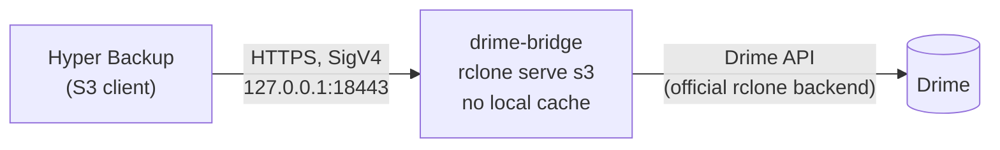

# Hyper Backup → Drime, on the NAS itself

Back up a Synology NAS to [Drime](https://drime.cloud) with **Hyper Backup**, straight from the NAS. No VPS, no relay server, no local staging copy.

Drime has no S3 or WebDAV endpoint, so Hyper Backup can't reach it on its own. This project runs a small local S3 endpoint on the NAS. It is [rclone](https://rclone.org)'s `serve s3` on top of rclone's [official Drime backend](https://rclone.org/drime/). Hyper Backup sees an ordinary S3 server on `127.0.0.1`, and every upload goes straight through to Drime.



> **Status: v0.1, ready for first real-world runs.** Every S3 behaviour Hyper Backup is known to depend on is covered by automated tests, which pass against rclone 1.75.2. What is not yet confirmed is a long-running Hyper Backup task on real DSM hardware. If you run it, please [report your results](../../issues/new?template=validation-report.yml). See [what is verified and what isn't](docs/research.md#7-what-is-verified-and-what-isnt).

## Why this design

- **An upload only counts once it is in Drime.** The bridge runs with rclone's VFS cache off. Hyper Backup's PUT is answered only after Drime has accepted the data, so a backup can't report success for data still sitting on a disk somewhere. That is the main failure mode of VPS relays and `rclone mount` caches.
- **Integrity is checked on every request.** Each upload comes back with the MD5 ETag Hyper Backup checks. A corrupted upload (bad `Content-MD5`) is rejected, and an interrupted upload never leaves a partial object behind (both tested).
- **It uses little of the NAS.** It's one static binary with no Docker required: about 35 MiB RAM idle and about 55–75 MiB while backing up. No disk space is used for staging.
- **It's built from maintained parts.** Drime lists the rclone backend as its official integration (Tier 1). Hyper Backup's S3 client is its most widely used cloud path. The glue here is a few hundred lines of POSIX shell.

The [research notes](docs/research.md) cover every alternative that was evaluated and why it lost: native WebDAV/S3, `rclone mount`, local folder plus sync, WebDAV bridge, community Drime gateways and VPS relays.

## Requirements

- DSM 7.x with Hyper Backup, on any Synology CPU (x86-64, ARMv8 or ARMv7)
- A Drime account and an API token (Drime → Settings → Developer)
- SSH access once, for the install

## Quick start

On the NAS, as root (`sudo -i` after SSH-ing in as an administrator):

```bash
cd /volume1
curl -fsSLO https://github.com/JannickNijholt/synology-hyperbackup-drime/archive/refs/tags/v0.1.0.tar.gz
tar xzf v0.1.0.tar.gz
sh synology-hyperbackup-drime-0.1.0/bridge/install.sh
```

The installer:

1. downloads rclone 1.75.2 and verifies its SHA-256
2. asks for your Drime token (hidden input) and checks it
3. creates the Drime folder `HyperBackup/hyperbackup`
4. creates a self-signed certificate and random S3 keys
5. starts the bridge and runs a health check

Everything lives in `/volume1/drime-bridge`, which is deliberately not a shared folder. You can delete the downloaded release folder afterwards.

Then, in DSM:

1. **Start at boot.** Control Panel → Task Scheduler → Create → Triggered Task → User-defined script. User `root`, event *Boot-up*, command:
   `/volume1/drime-bridge/drime-bridge.sh start`
2. **Create the backup.** Hyper Backup → **+** → Data backup task → **S3 Storage**:

   | Field | Value |
   |---|---|
   | S3 Server | Custom Server URL |
   | Server address | `127.0.0.1:18443` |
   | Signature version | v4 |
   | Request style | Path style |
   | Access key / Secret key | printed by the installer, also in `/volume1/drime-bridge/bridge.conf` |
   | Bucket name | `hyperbackup` |

   Turn on client-side encryption, and set the multipart upload part size to 64 MB if your version shows it. The reasons are in [Hyper Backup settings](docs/hyper-backup.md).

Optional but recommended: run `/volume1/drime-bridge/selftest.sh` once. It pushes real single-part and multipart uploads through the bridge, reads them back byte-for-byte and confirms they landed in Drime.

[Full setup guide](docs/setup.md) · [Container Manager variant](docs/setup.md#option-b-container-manager)

## Day to day

```bash
/volume1/drime-bridge/drime-bridge.sh status     # running? listening? memory
/volume1/drime-bridge/drime-bridge.sh health     # end to end: S3 -> bridge -> Drime
/volume1/drime-bridge/drime-bridge.sh logs 100
/volume1/drime-bridge/drime-bridge.sh restart
```

If rclone ever exits, the bridge restarts it automatically. [Operations](docs/operations.md) covers monitoring, upgrades, tuning for low-RAM models, troubleshooting and uninstalling.

## Measured resource use

These are Linux numbers for the bridge process (rclone 1.75.2, arm64, measured in a container), with Hyper Backup-style traffic:

| Workload | Peak RAM |
|---|---|
| Idle | ~35 MiB |
| Sequential 50 MB uploads (Hyper Backup's usual pattern) | ~53 MiB |
| 1 GB multipart, parts in order | ~52 MiB |
| 1 GB multipart, 4 parts in parallel, out of order | ~180 MiB (capped by `MULTIPART_BUFFER_TOTAL`) |

The real Drime backend adds up to about 20 MiB of upload buffers per file in flight. CPU use is mostly TLS and MD5, which is light even on ARM. No disk space is used apart from logs (rotated, about 20 MB at most).

## Restoring

- **On the same NAS or a new one:** install the bridge with the same Drime account. In Hyper Backup, choose Restore → Data → S3 Storage with the same settings and pick the existing task. Its data lives in Drime, not on the NAS.
- **Without any NAS:** download the task's `.hbk` folder from Drime (`rclone copy`), then open `SynologyHyperBackup.bkpi` in the desktop Hyper Backup Explorer. Details are in [Hyper Backup settings](docs/hyper-backup.md#restoring).

Test a restore early. A backup you have never restored is a hope, not a backup.

## Security

- The bridge listens on `127.0.0.1` only, so nothing on your network can reach it.
- The Drime token and S3 keys are stored with mode `600` in a root-only folder and passed to rclone through the environment, never on the command line.
- Use Hyper Backup's client-side encryption so Drime only ever stores ciphertext.

Read [SECURITY.md](SECURITY.md) before reporting a vulnerability.

## Contributing

`tests/run-local.sh` runs the whole bridge against a stand-in for Drime, so you need neither a NAS nor a Drime account. CI runs it weekly against the newest rclone release. The most useful contribution right now is a [validation report](../../issues/new?template=validation-report.yml) from a real NAS. See [CONTRIBUTING.md](CONTRIBUTING.md).

## Disclaimer

This is an independent community project. It is not affiliated with, endorsed by or supported by Synology or Drime. Synology, DSM and Hyper Backup are trademarks of Synology Inc. Drime is a trademark of its owner. It comes with no warranty (see [LICENSE](LICENSE)). Keep more than one backup of anything you can't afford to lose.
